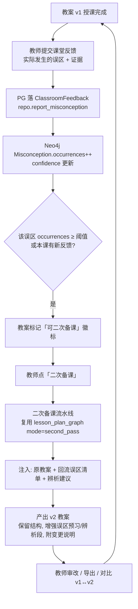

# 二期功能设计：误区回流 · 二次备课飞轮 · 教研数据看板（含合规红线）

> 承接一期「使用 → 反馈 → 补全」闭环，把"反馈"从**教师凭经验提交建议**升级为**课堂真实误区回流 + 教案可二次生成**，并让教研员能基于全局数据做区域级洞察。
> 本文档只设计**本期（二期）范围**，并在末尾以硬约束明确**不碰**的合规红线。

---

## 0. 定位与边界

| 维度 | 一期现状 | 二期目标 |
|---|---|---|
| 反馈来源 | 教师手动提交 `KnowledgeSuggestion(kind=misconception)` | 增加**结构化课堂反馈** `ClassroomFeedback`，回流到图谱 `Misconception` |
| 反馈去向 | 进审核队列，人工通过才入图 | 入图自动累计 `occurrences` + `confidence`，高频误区直接可见 |
| 教案生成 | 仅"首次生成" | 增加"**二次备课**"：基于回流误区分支产出 v+1 版本 |
| 数据消费 | 仅教师个人备课 | 教研员可看**区域级覆盖率 / 高频误区 TOP / 质量基线** |

**本期硬边界（合规红线，见 §3）**：不引入任何学生学情 / 成绩 / 姓名 / 学号数据。所有误区与反馈均**去标识化**。

---

## 1. 误区回流 + 二次备课飞轮

### 1.1 概念区分（避免和一期混淆）

- **一期 `KnowledgeSuggestion(kind=misconception)`**：教师"我认为学生容易错这里"，**经验型**、需人工审核、不确定是否真的发生。
- **二期 `ClassroomFeedback`**：教师"这节课实际有 X 个学生在这个误区上栽了，证据是……"，**实证型**、回流即累加到图谱、带 `occurrences` 计数。
- 二者共存：经验型仍走审核队列；实证型课堂反馈直接增强图谱信号，但**仍受合规隔离约束**（见 §3，不含学生身份）。

### 1.2 数据模型

#### Neo4j：`Misconception` 节点扩属性（复用既有 `content`/`correction`）

```cypher
// 在 create_misconception 的 CREATE 语句中追加以下属性
CREATE (m:Misconception {
  id: $id,
  content: $content,
  correction: $correction,
  occurrences: 0,            // 回流累计次数（本期核心信号）
  confidence: 0.0,           // 0~1，由 occurrences 与来源加权得到
  last_reported_at: null,    // 最近一次回流时间
  evidence_refs: [],         // 关联的 ClassroomFeedback.id 列表（去标识，无学生身份）
  status: 'published'
})
```

> 约束：仍需 `CREATE CONSTRAINT misconception_id IF NOT EXISTS FOR (m:Misconception) REQUIRE m.id IS UNIQUE`（已在 `app/core/neo4j.py` 存在，无需新增）。

新增仓储方法（在 `app/knowledge_graph/repository.py`）：

```python
def report_misconception(self, kp_id: str, content: str, evidence_feedback_id: str,
                         severity: int = 1) -> dict | None:
    """课堂反馈回流：命中既有误区则 occurrences++、刷新 last_reported_at、
    追加 evidence_refs；未命中则按名称 MERGE 一个误区（status=published，occurrences=1）。"""
    # MATCH (kp)-[:HAS_MISCONCEPTION]->(m {content:$content})
    #   SET m.occurrences = m.occurrences + 1,
    #       m.last_reported_at = datetime(),
    #       m.evidence_refs = m.evidence_refs + $fid
    # 失败分支：MERGE (m2:Misconception {content:$content}) ... 并 link_kp_misconception
```

#### PostgreSQL：新增 `ClassroomFeedback` 表（审计日志型，去标识）

```python
class ClassroomFeedback(SQLModel, table=True):
    """课堂真实误区回流事件（实证型，去标识，无 student_id）。"""
    id: uuid.UUID = Field(default_factory=uuid.uuid4, primary_key=True)
    org_id: uuid.UUID = Field(foreign_key="organization.id", nullable=False, index=True)
    submitter_id: uuid.UUID = Field(foreign_key="user.id", nullable=False, ondelete="CASCADE")
    lesson_plan_id: uuid.UUID | None = Field(default=None, index=True)   # 关联被授课的教案版本
    kp_id: str = Field(index=True)                                       # 指向 Neo4j KnowledgePoint.id
    misconception_content: str = Field(max_length=2000)                  # 实际发生的误区描述
    evidence: str | None = Field(default=None, max_length=2000)          # 证据片段（如典型错误答法，去标识）
    severity: int = Field(default=1, ge=1, le=3)                         # 发生广度 1~3
    session_date: datetime | None = Field(default=None, sa_type=DateTime(timezone=True))
    created_at: datetime | None = Field(default_factory=get_datetime_utc, sa_type=DateTime(timezone=True))
    # ⚠️ 合规隔离区：本表严禁新增 student_id / 姓名 / 学号 等字段
```

新 Alembic 迁移：`add_classroom_feedback.py`（参考 `b7c3d1e9f0a1_add_candidate_kp_and_logs.py` 写法）。

### 1.3 飞轮业务流程



### 1.4 与现有 `lesson_plan_graph` 的关系（最小改动）

在 `app/agent/graphs/lesson_plan_graph.py` 增加一个 `mode` 入参：

- `mode="first_pass"`（默认）：现有流程不变。
- `mode="second_pass"`：输入 = `{ original_plan, kp_ids,回流误区清单, verify_report(v1) }`。
  - 跳过"从头收集上下文"，直接复用 v1 的 `knowledge_point_ids`；
  - LLM 提示词约束：**保留 v1 教学目标/过程骨架，仅在"误区预习""易错辨析""课堂检测"段增补已回流高频误区**；
  - 末段复用现有 `verify` 节点重跑校验，确认新误区已被覆盖（呼应一期流程 C）。

> 这样"二次备课"不是从零生成，而是**定向补全**，成本更低、教师更敢用。

### 1.5 前端改动（教师端）

| 页面 | 新增元素 | 功能 |
|---|---|---|
| 教案编辑页 | 「课堂反馈」按钮 | 弹窗填：实际发生的误区 + 证据片段 + 发生广度；提交后回流图谱 |
| 教案编辑页 | 「二次备课」按钮 + 版本对比 | 触发 second_pass；v1↔v2 diff 视图（变更段高亮） |
| 工作台 | 教案卡片「可二次备课」徽标 | 当关联误区 `occurrences` 达阈值时显示，引导回流复用 |

---

## 2. 教研数据看板（区域级）

### 2.1 三类核心指标与定义

| 指标 | 定义 | 数据源 | 聚合维度 |
|---|---|---|---|
| **区域级知识点覆盖率** | 已 `published` 知识点 / 该范围内应覆盖知识点（按章节树叶子节点） | Neo4j `KnowledgePoint` + PG `Chapter` 树 | region → school → 学科 → 章节 下钻 |
| **高频误区 TOP** | 按 `Misconception.occurrences` 降序，叠加 `ClassroomFeedback` 频次 | Neo4j `Misconception` + PG `ClassroomFeedback` | 学科 / 章节 / 时间窗 |
| **教案质量基线** | verify_report 通过率 / 平均完整度 / 考纲覆盖度 / 误区覆盖度 | PG `LessonPlan.verification_report` | 学校 / 教研组 / 教师 |

### 2.2 聚合方案（复用现有架构）

**覆盖率（Cypher，Neo4j）** —— 统计章节叶子节点下已关联 `published` 知识点：

```cypher
MATCH (c:Chapter)<-[:BELONGS_TO*]-(leaf:Chapter)
WHERE c.id = $chapter_id AND NOT (leaf)-[:HAS_CHILD]->()
OPTIONAL MATCH (leaf)-[:COVERS]->(kp:KnowledgePoint {status:'published'})
RETURN count(DISTINCT leaf) AS total, count(DISTINCT kp) AS covered
```

**高频误区 TOP（Cypher，Neo4j）**：

```cypher
MATCH (kp:KnowledgePoint)-[:HAS_MISCONCEPTION]->(m:Misconception)
WHERE kp.subject = $subject AND m.occurrences > 0
RETURN kp.name AS 知识点, m.content AS 误区, m.occurrences AS 回流次数
ORDER BY m.occurrences DESC LIMIT 20
```

**质量基线（SQL，PG）** —— 直接聚合既有 `verification_report` JSON（一期已产出，无需新埋点）：

```sql
SELECT org_id,
       avg((verification_report->'completeness_score')::int) AS avg_completeness,
       avg((verification_report->'exam_coverage')::float)   AS avg_exam_cov,
       avg((verification_report->'misconception_coverage')::float) AS avg_mis_cov,
       count(*) FILTER (WHERE verification_report->>'passed' = 'true') * 1.0 / count(*) AS pass_rate
FROM lessonplan WHERE verification_report IS NOT NULL
GROUP BY org_id;
```

### 2.3 新增 API（归入新路由 `app/api/routes/research.py`）

| 方法 | 路径 | 说明 | 权限 |
|---|---|---|---|
| GET | `/api/v1/research/dashboard/summary` | 看板总览（三类指标合一） | `research_admin` |
| GET | `/api/v1/research/coverage` | 知识点覆盖率（支持 `org_id`/`subject`/`chapter_id`） | `research_admin` |
| GET | `/api/v1/research/misconceptions/top` | 高频误区 TOP（支持时间窗/学科） | `research_admin` |
| GET | `/api/v1/research/lesson-plan-quality` | 教案质量基线 | `research_admin` |

> 权限：在 `Role`/`Permission` 体系新增 `research_admin` 角色与 `research:view` 权限点（复用一期 RBAC + org 树 `school`/`region` 上卷，无需新机制）。

### 2.4 前端页面（教研员视角，新增"教研看板"模块）

- **区域看板页**：左覆盖率仪表盘（region 总览 + 各校对比条形图）、中高频误区 TOP 榜（可点击下钻到章节）、右教案质量基线卡（通过率/完整度/考纲覆盖）。
- **下钻交互**：region → school → 学科 → 章节，逐级 `org_id` 过滤。
- 复用一期 `DashboardSummary` / `ScenarioCard` 契约，把"教研看板"作为 `audience_tags:["research_admin"]` 的场景卡注入。

---

## 3. 合规红线（本期硬约束）

### 3.1 数据分类与边界

| 数据类型 | 含未成年人个人信息？ | 本期处理 |
|---|---|---|
| 知识点 / 考点 / 误区（内容本身） | 否 | ✅ 可用 |
| 教师提交的课堂反馈（误区描述 + 证据片段，**去标识**） | 否（强制去标识） | ✅ 可用 |
| 教师教案 / 校验报告 | 否 | ✅ 可用 |
| **学生学情 / 成绩 / 姓名 / 学号 / 班级排名** | **是（强合规）** | ❌ **本期不碰** |

### 3.2 三条不可突破的原则

1. **最小必要**：课堂反馈只采集"误区描述 + 证据片段 + 发生广度"，**绝不绑定学生身份**。`ClassroomFeedback` 表无 `student_id`/姓名/学号字段（代码注释标注「合规隔离区」）。
2. **单独脱敏、单独授权**：未来若确需引入学生数据，必须作为**独立模块**、走**独立授权流程**、有**独立审计日志**；不与本系统的图谱/反馈数据混表。
3. **本期默认关闭**：任何"按学生维度"的聚合、排行、画像功能**一律不做**。看板只到"知识点 / 误区 / 教案"粒度，不到"人"。

### 3.3 落地检查项（Code Guard）

- [ ] `ClassroomFeedback` 模型无 `student_id`/`name`/`student_no` 字段；
- [ ] 前端反馈表单不渲染任何学生身份信息输入；
- [ ] `report_misconception` 写入 Neo4j 的 `evidence_refs` 仅存去标识 feedback id；
- [ ] 教研看板所有接口返回不含学生级字段（DTO 白名单）；
- [ ] 在 `docs/技术架构与设计文档.md` 与本文档顶部均标注「合规隔离区」说明。

---

## 4. 落地优先级与里程碑

| 阶段 | 内容 | 依赖 |
|---|---|---|
| M1 | `ClassroomFeedback` 表 + 迁移 + `report_misconception` 仓储 | 一期 Neo4j/Misconception 已就绪 |
| M2 | 教师端「课堂反馈」提交 + 误区 `occurrences` 回流 | M1 |
| M3 | `lesson_plan_graph` `mode=second_pass` + 二次备课按钮 + v1↔v2 对比 | M2 |
| M4 | 教研看板 API（覆盖率/误区TOP/质量基线）+ `research_admin` 权限 | 一期 org 树/RBAC |
| M5 | 教研看板前端页 + 下钻 | M4 |
| — | 学生学情/成绩数据 | **全部挂起，遵守 §3** |

## 5. 复用清单（避免重复造轮子）

- `Misconception` 节点 & `HAS_MISCONCEPTION` 关系 —— 已存在，仅扩属性；
- `lesson_plan_graph` 的 `verify` 节点 —— 二次备课直接复用；
- `KnowledgeSuggestion` / `CandidateKnowledgePoint` 审核队列模式 —— 经验型误区仍走此路；
- `LessonPlan.verification_report` —— 质量基线零新增埋点直接聚合；
- `Organization` 树（school/region）+ RBAC —— 看板上卷与 `research_admin` 权限直接复用；
- `DashboardSummary` / `ScenarioCard` 契约 —— 看板入口注入复用。

---

### 一句话总结（答辩可用）

> 二期把一期的"教师经验反馈"升级为"课堂实证误区回流"，让 `Misconception` 节点长出 `occurrences` 信号，驱动教案**二次备课**飞轮；同时把全局图谱与教案校验数据沉淀为**区域级教研看板**——全程严守未成年人数据合规红线，学生学情数据本期一律不碰。
